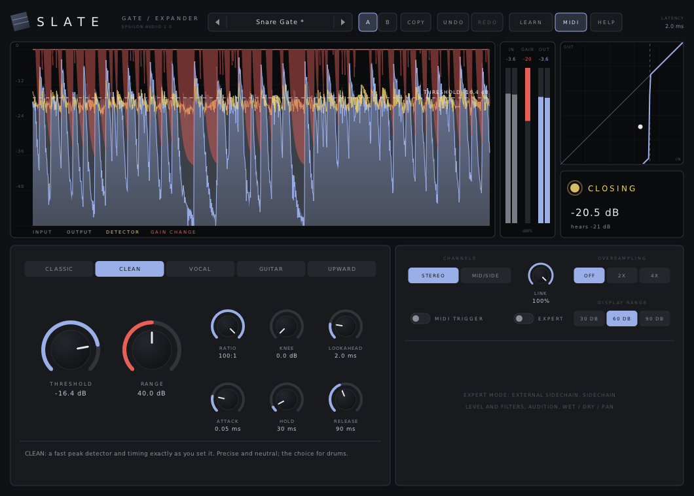
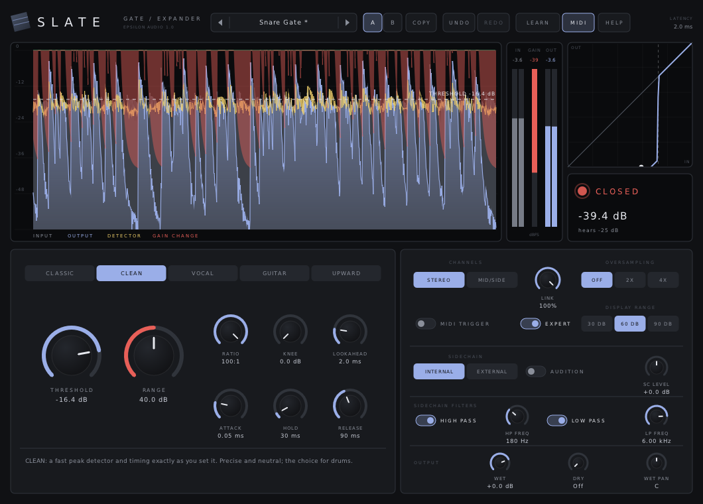
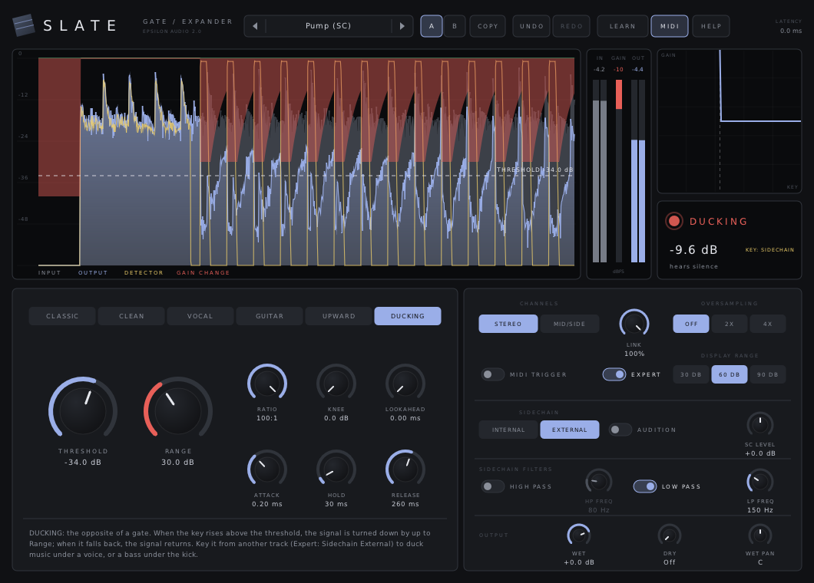

# Slate

**A gate, expander and ducker with six styles, sidechain filters and MIDI triggering, for macOS, Windows and Linux (VST3 · AU · CLAP · VST2).**

Part of **[Epsilon Audio](https://github.com/natehouk/epsilon-plugins)**, a family of free, open-source plugins: Monolith, Caldera, Obsidian, Strata, Basalt, Gneiss, Mica, Flint, Granite, Magma, Schist, Slate, Talc, Geode and Malachite.



Slate is a clean-room design with the feature set of FabFilter Pro-G, FabFilter's tenth plugin (May 2011). It was written from scratch, working only from FabFilter's public release announcement and contemporary news coverage. No FabFilter code, binaries, presets, artwork or trademarks were used.

It is part of a family of plugins:
- [Monolith](https://github.com/natehouk/monolith) (synth)
- [Caldera](https://github.com/natehouk/caldera) (filter)
- [Obsidian](https://github.com/natehouk/obsidian) (polysynth)
- [Strata](https://github.com/natehouk/strata) (tape delay)
- [Basalt](https://github.com/natehouk/basalt) (live dual filter)
- [Gneiss](https://github.com/natehouk/gneiss) (compressor)
- [Mica](https://github.com/natehouk/mica) (equalizer)
- [Flint](https://github.com/natehouk/flint) (small filter)
- [Granite](https://github.com/natehouk/granite) (limiter)
- [Magma](https://github.com/natehouk/magma) (multiband distortion)
- [Schist](https://github.com/natehouk/schist) (multiband dynamics)
- **Slate**, a rock that splits clean along its layers

## Download

Get the latest build from [**Releases**](../../releases):

| Platform | File | Contains |
|---|---|---|
| macOS 10.13+ (Apple Silicon + Intel) | `Slate-macos-universal.zip` | VST3, AU, CLAP, manual |
| Windows x64 | `Slate-windows-x64.zip` | VST3, CLAP, VST2, manual |
| Linux x64 | `Slate-linux-x64.zip` | VST3, CLAP, VST2, manual |

### Install

| Platform | Copy | To |
|---|---|---|
| macOS | `Slate.vst3` / `Slate.component` / `Slate.clap` | `~/Library/Audio/Plug-Ins/VST3` / `Components` / `CLAP` |
| Windows | `Slate.vst3` (folder) / `Slate.clap` | `C:\Program Files\Common Files\VST3\` / `CLAP\` |
| Linux | `Slate.vst3` / `Slate.clap` | `~/.vst3/` / `~/.clap/` |

**macOS:** builds are notarized once the project's Apple signing credentials are set up. Until then they are ad-hoc signed; after copying, run:

```
xattr -dr com.apple.quarantine ~/Library/Audio/Plug-Ins/*/Slate*
```

## Features

**Six styles**

| Style | Character |
|---|---|
| Classic | Smooth RMS expander; closes more gently after long openings |
| Clean | Fast peak detector, timing exactly as set; the choice for drums |
| Vocal | Slower RMS detection, softer knee, 4 dB hysteresis against chatter |
| Guitar | Peak detection, 8 dB hysteresis, closes quickly as notes die away |
| Upward | Upward expansion: lifts what rises above the threshold |
| Ducking | Turns the signal down while the key (usually the sidechain) is above the threshold: music under a voice, bass under the kick, sidechain pumping |

**Controls**
- Threshold, ratio (1:1 to 100:1), range (up to 80 dB) and soft knee.
- Attack, hold and release. The gate opens as a smooth fade in level and closes as an even fade in dB.
- Lookahead up to 10 ms, or zero latency without it.
- Stereo or mid/side, with variable linking.
- 2× or 4× linear-phase oversampling of the gain stage.
- **MIDI triggering:** held notes open the gate. Play it from a keyboard or a MIDI clip.

**Expert mode**
- External sidechain.
- Sidechain level, 48 dB/oct high-pass and low-pass filters, and audition.
- Separate wet and dry levels for parallel gating, and wet pan.

**Display and workflow**
- **Scrolling level display** showing:
  - input and output
  - the level the gate hears
  - the gain change
  - a draggable threshold line, with the hysteresis close point
- **Transfer curve** with a live dot, and a **gate state** readout (open, closing, closed).
- Input, gain-change and output meters.
- A/B with copy, undo/redo for every edit, MIDI Learn.
- Smoothed, sample-accurate automation.
- Resizable interface.
- **39 factory presets** in six categories, including seven ducking presets, plus user presets.
- The preset browser **searches** names and categories as you type, and a star keeps a preset in **Favourites**.
- **Hover tips** everywhere, a **HELP window**, and a **[full manual](docs/MANUAL.md)** (also in every release zip as `Slate-Manual.html`).





### Compared with FabFilter Pro-G (2011)

| Pro-G | Slate |
|---|---|
| Algorithms: Classic, Clean, Vocal, Guitar, upward expansion and Ducking (current Pro-G) | ✓ all six |
| Program-dependent attack and release curves | ✓ per style (gentler closing after long openings, hysteresis, fast close on decaying notes) |
| Threshold, ratio, range, attack, hold, release, knee | ✓ |
| Optional look-ahead up to 10 ms; zero-latency operation | ✓ |
| Real-time level display, transfer curve, input/output/gain-reduction metering | ✓ plus detector trace and gate state |
| Expert mode: external sidechain, sidechain filtering, flexible routing and linking | ✓ sidechain level, high/low-pass, audition, link, mid/side |
| Separate dry/wet levels and panning | ✓ wet, dry and wet pan |
| Mono, stereo or mid/side processing | ✓ stereo and mid/side (a stereo plugin; use it on mono tracks as usual) |
| Up to 4× linear-phase oversampling | ✓ |
| MIDI triggering | ✓ |
| MIDI Learn, undo/redo, A/B, smooth parameter changes, help with interactive hints | ✓ hover tips, help pages and full manual |
| Factory presets | 39 factory presets plus user presets |
| Pro Tools (RTAS/AAX) | Not supported (needs Avid's SDK and signing) |

## Build from source

The plugin is built on [DPF](https://github.com/DISTRHO/DPF):

```
git clone --recursive https://github.com/DISTRHO/DPF.git dpf
make -C plugins/Slate                    # Linux / macOS (macOS also builds the AU)
make -C plugins/Slate WINDOWS=true CC=x86_64-w64-mingw32-gcc CXX=x86_64-w64-mingw32-g++
```

GitHub Actions builds all three platforms on every push. The macOS build is universal. It is signed and notarized when the Developer ID secrets are set (`MACOS_CERT_P12`, `MACOS_CERT_PASSWORD`, `NOTARY_KEY`, `NOTARY_KEY_ID`, `NOTARY_ISSUER`), and ad-hoc signed otherwise. A `v*` tag, or a release published on GitHub, attaches the zips to that release.

## Tests

```
cd tests
g++ -O2 -std=c++11 features.cpp -o features && ./features   # open/closed levels per style, ratio, range, knee, upward expansion, attack/hold/release,
                                                            # hysteresis, latency and look-ahead, oversampling, external sidechain, sidechain level,
                                                            # filters and audition, MIDI trigger, wet/dry/pan, link, mid/side,
                                                            # ducking depth, ratio and timing, MIDI ducking
g++ -O2 -std=c++11 fuzz.cpp -o fuzz && ./fuzz               # random parameters, MIDI and sidechain at 44.1-192 kHz: always finite
g++ -O2 -std=c++11 presets.cpp -o presets && ./presets      # plays a drum loop with a noise floor through every preset
g++ -O3 -std=c++11 bench.cpp -o bench && ./bench            # CPU at 1x, 2x and 4x
```

Slate takes about 1.2% of one CPU core (2.2% at 4× oversampling).

Release checks:
- Steinberg's VST3 validator passes 47/47.
- The interface is exercised with scripted input and a live drum-and-bass test mix: presets, dragging the threshold, expert mode, ducking keyed from the sidechain, tips and help.

## Source layout

| File | Contents |
|---|---|
| `plugins/Slate/SlateEngine.hpp` | All DSP: detectors, gain computer, attack/hold/release, sidechain filters, oversampling, level history. Header-only |
| `plugins/Slate/ParamDefs.hpp` | Parameter table, labels, value mapping |
| `plugins/Slate/Presets.hpp` | Factory presets |
| `plugins/Slate/UserPresets.hpp` | User preset files |
| `plugins/Slate/Help.hpp` | Hover tip text and in-plugin help pages |
| `plugins/Slate/SlatePlugin.hpp/.cpp` | Plugin wrapper: parameters, sidechain, MIDI triggering, latency, MIDI Learn |
| `plugins/Slate/SlateUI.cpp` | Custom vector interface (NanoVG) |
| `docs/MANUAL.md` | User manual (`Slate-Manual.html` is generated from it with pandoc) |

## Changelog

- **2.1:** the preset browser searches names and categories as you type, and keeps Favourites.
- **2.0:** DUCKING style: turns the signal down while the key is above the threshold, with its own transfer curve and gate-state readout, MIDI ducking, and seven ducking presets. Sessions and automation from 1.0 load unchanged.
- **1.0:** First release.

## License

[MIT](LICENSE). Built with [DPF](https://github.com/DISTRHO/DPF) and its bundled NanoVG, which are under the ISC license. `plugins/Slate/ResizeHandle.hpp` comes from DPF's examples and keeps its ISC notice.

"FabFilter" and "FabFilter Pro-G" are trademarks of FabFilter Software Instruments. Slate is not affiliated with or endorsed by FabFilter.
